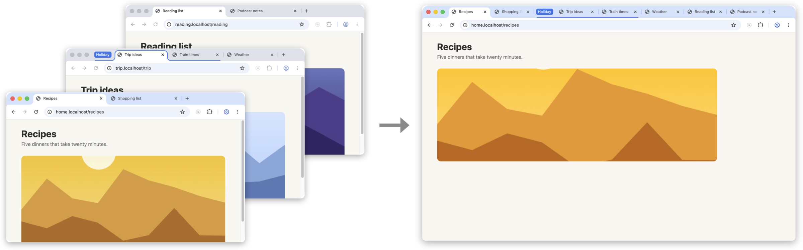

# Merge Windows Chrome Extension 🪟

One button in your Chrome toolbar. Click it and every other Chrome window folds into the one you're looking at. Minimised ones, popups, that window you forgot about on the other desktop: all of it. No options page, no settings, no menu. Click, done.



## What you get 🧲

- **Every window**, including minimised ones and popup windows (the little chromeless ones that sign-in flows and web apps love to spawn).
- **Tabs stay in order.** Windows come across one after another, and each window's tabs keep the order they had.
- **Tab groups survive.** A group moves over whole, with its name, its colour and whether it was collapsed. 🎨
- **Pinned tabs stay pinned**, and line up with the pinned tabs you already had.
- **Incognito stays incognito.** Click in an ordinary window and the incognito ones are left alone, and the other way round. Chrome won't mix them anyway.
- **Empty windows vanish** once their last tab has moved.

## Install it 🔧

You need [Node.js](https://nodejs.org) 22 or newer, and Chrome 126 or newer.

1. Grab the code and build it:

   ```bash
   git clone https://github.com/christianjbrown/chrome-extension-merge-windows.git
   cd chrome-extension-merge-windows
   npm ci
   npm run build
   ```

   That makes a `dist` folder, which is the actual extension.

2. Open `chrome://extensions` in Chrome.
3. Flip on **Developer mode** (top right).
4. Click **Load unpacked** and pick the `dist` folder.
5. Click the puzzle piece 🧩 in the toolbar and hit the pin next to **Christian's Merge Windows**.

### Updating 🔄

```bash
git pull
npm ci
npm run build
```

Then hit the reload arrow on the Christian's Merge Windows card in `chrome://extensions`.

## Good to know 🤓

- **It merges into the window you clicked in.** Whatever's in there stays put, and everything else lands after it.
- **Incognito windows** only get merged if you've turned on **Allow in Incognito** for the extension in `chrome://extensions`, and then only into another incognito window.
- **App windows** (installed web apps running in their own window) and DevTools are left alone. They aren't really browser windows.
- **A red `!` on the button** means something went wrong. Hover over it and the tooltip says what.
- **It asks for five permissions:** `tabGroups` so it can move groups whole, `offscreen` to check whether your computer is light or dark, `activeTab` and `scripting` to read the light or dark setting from the tab you click the button in (only then, and nothing else in it), and `storage` to remember which one Chrome is in. It never reads your pages, URLs or tab titles.
- **The button dresses for the occasion.** Almost black on a light toolbar, almost white on a dark one, It follows your computer by itself. If you've set Chrome to Light or Dark separately, it catches on the first time you click it, and remembers. 🌗

## No tracking 🔒

No analytics, no tracking, no ads, no accounts, and nothing phoning home. It never talks to the internet at all, so nothing about your windows or tabs leaves your machine.

## Development 🛠️

It's TypeScript, bundled with esbuild, tested with Vitest.

```bash
npm test          # the unit tests
npm run ci        # everything CI checks: format, lint, types, unused code, 100% coverage, build
```

`npm run ci` is exactly what CI runs, and coverage has to stay at 100% for lines, branches, functions and statements, or it fails. Lint also holds every function in `src` to a single decision, so full branch coverage means every path gets tested too. To run it before every push, point git at the committed hook: `git config core.hooksPath .githooks`.

How it fits together, all in `src`:

- **`main.ts`** wires the pieces to Chrome. Nothing else touches `chrome` directly.
- **`scheme-document.ts`, `scheme-reporter.ts` and `scheme-listener.ts`** keep the button's colour in step with Chrome: a hidden offscreen document checks light or dark once a second and the service worker swaps the icon.
- **`scheme-state.ts`, `scheme-rules.ts`, `scheme-store.ts`, `toolbar-scheme.ts`, `tab-scheme.ts` and `click-scheme.ts`** sort out which report to believe: the device's, or the one a clicked tab gives for Chrome's own setting, which wins and is kept in `chrome.storage.local`. `serial-queue.ts` takes the reports one at a time.
- **`merge-controller.ts`** handles a click: merge, then clear the badge or show what went wrong. `main.ts` hands it both looks from `merge-looks.ts`, and `toolbar-indicator.ts` puts whichever it picks on the button.
- **`window-merger.ts`** fetches every normal and popup window and runs the plan for the ones that can give their tabs.
- **`ordinary-targets.ts`** decides which those are: only an ordinary window takes tabs, and incognito stays with incognito.
- **`tab-order-planner.ts`** works out the moves by asking each kind of planning `main.ts` lists. `window-moves-planning.ts` splits each window into runs with the splitter `main.ts` gives it (`tab-runs.ts`, behind `run-splitter.ts`) and hands them to `loose-tabs-planning.ts` and `group-planning.ts`, so loose tabs go in one go and groups go whole. Then `pin-planning.ts` re-pins the pinned ones. Each kind decides for itself whether it has anything to do.
- **`tabs-move.ts`, `group-move.ts` and `pin.ts`** are the moves themselves, as `chrome.tabs` and `chrome.tabGroups` calls. Each one brings its own builder and says what it needs to know, and `main.ts` hands each builder to its kind of planning. A new kind of move is a new move, a new kind of planning and one line there.

Every class gets its collaborators through its constructor, behind an interface in a small file of its own (`merger.ts`, `scheme-memory.ts` and friends), so each one is tested on its own with fakes.

## Licence 📄

MIT. See [LICENSE](LICENSE).
